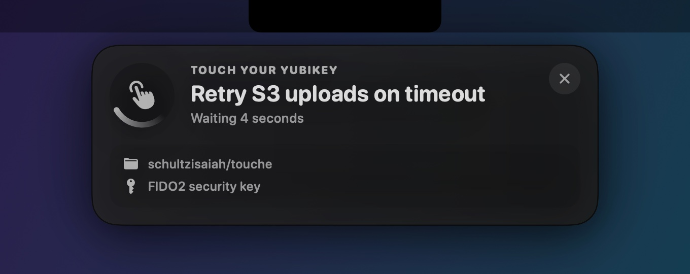
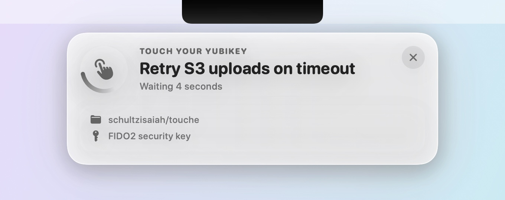
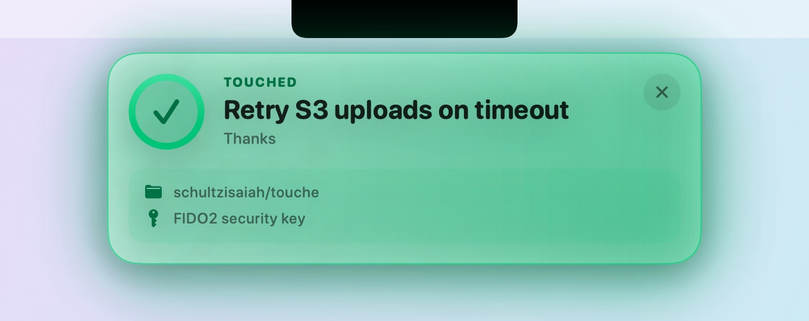
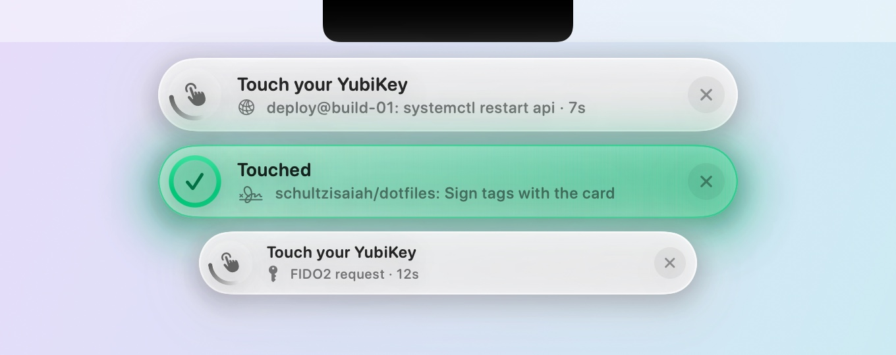

<h1 align="center">Touché</h1>

<p align="center"><b>YubiKey touch notifications for macOS.</b><br>An alert under the notch when your security key is waiting for a touch.</p>

<p align="center"><a href="https://github.com/schultzisaiah/touche/releases/latest">Download</a> · <code>brew install --cask schultzisaiah/tap/touche</code></p>

<p align="center">
  
  
</p>

You run `git commit -S` or `ssh`, the YubiKey starts blinking, and the terminal just sits there. Touché lives in your menu bar and catches that moment. A card drops out from under the notch, says who's asking (the repo and commit, or the host), and stays until you touch the key. Then it turns into a checkmark and leaves on its own.

It works with FIDO2 keys (ssh `sk-` keys, `ssh-keygen -Y sign` for git signing) and OpenPGP cards (gpg signing). It's the macOS answer to [yubikey-touch-detector](https://github.com/maximbaz/yubikey-touch-detector) on Linux, and does what [ykding](https://github.com/onyb/ykding) and [yknotify](https://github.com/noperator/yknotify) do, with its own alerts instead of macOS notification banners.

## Install

```sh
brew trust schultzisaiah/tap
brew install --cask schultzisaiah/tap/touche
```

Homebrew asks you to trust a tap once before it loads anything from it. Or download the DMG from the [latest release](https://github.com/schultzisaiah/touche/releases/latest) and drag Touché to Applications. Releases are signed and notarized, and run on macOS 14 or later, on Apple silicon or Intel. `brew upgrade` picks up new versions.

## The alert

<p align="center">
  <picture>
    <source media="(prefers-color-scheme: dark)" srcset="docs/screenshots/touched-dark.jpg">
    
  </picture>
  <picture>
    <source media="(prefers-color-scheme: dark)" srcset="docs/screenshots/pills-dark.jpg">
    
  </picture>
</p>

- **Who's asking**: the repo and commit subject when git is signing (with ssh-keygen or gpg), or the host and remote command when ssh is authenticating. A request you didn't start shows up as something you don't recognize, instead of training you to tap whenever the key blinks.
- **Three sizes**: Compact and Regular pills, or a Large card (the default) that adds a detail panel with the repo or remote command and the kind of key.
- **Two positions**: under the notch (the default), or the center of the screen.
- **Waiting ring** that circles until the touch lands, then closes into a full ring and a checkmark.
- **Black while waiting** in dark mode (white in light mode), whatever asked, and **mint once touched**. The menu bar key turns into a tapping hand while a request waits.
- **Pop** when a request comes in, or any macOS system sound, or none.
- **Swipe right to dismiss**, with two fingers or by dragging. The trackpad clicks at the point of no return. Pull back to cancel.
- **Every display** gets the pill, or just the one your pointer is on.
- **Screen-edge glow**, off by default.
- **Left out of screen shares and recordings**, so a call doesn't see which repo or host you're touching for.

A rebase that re-signs five commits shows five pills in a row, one per touch.

## When a request ends

| Kind | Ends when |
|---|---|
| FIDO2 | The key stops waiting, which macOS logs. Touched requests show a checkmark first. A request with no end message leaves after 35 seconds. |
| OpenPGP | The card replies to gpg. An OK reply means it was touched and shows a checkmark first. An error reply, or 5 seconds without gpg repeating its request, ends it without one. |

## Menu

Click the key in the menu bar for:

- Whether Touché is watching (it restarts `log stream` if it exits).
- The last five requests, with a checkmark on the ones that were touched.
- A preview of each kind of request.
- Size, Position, Sound, Glow Around the Screen, Show on Every Display, and Open at Login.

## How it works

The detection follows [yknotify](https://github.com/noperator/yknotify). While a key waits for a touch, macOS logs telltale messages: the kernel for FIDO2, `usbsmartcardreaderd` for OpenPGP. Touché tails `log stream` for them. For gpg it also watches for the card's reply, which is how it knows the touch landed. The messages are a heuristic, not an API, so a macOS update can change them.

The requester lookup is ported from ykding. For git signing it finds the `ssh-keygen -Y sign` or `gpg -bsau` process, takes the repo from its working directory, and reads the commit subject from the git dir. For ssh it finds `ssh-sk-helper` and reads the destination off its parent's command line. If anything fails (or the key lives in ssh-agent, whose requests carry no destination) the alert says "FIDO2 request".

## Build from source

Requires macOS 14 or later and the Swift toolchain that ships with Xcode.

```sh
./build.sh            # build build/Touché.app
./build.sh run        # build, then launch it
./build.sh install    # build, copy to /Applications, and launch (needed for Open at Login)
swift test            # detection, requester parsing, and swipe tests
```

`build/Touché.app --args --preview` plays both kinds of request on launch.

The screenshots are rendered from the real views, under a stand-in notch, in dark and light mode:

```sh
./build.sh && build/Touché.app/Contents/MacOS/Touche --snapshots docs/screenshots
```

If ykding is also running, you'll get both: `brew services stop ykding`.

## Releasing

Run the [Release workflow](.github/workflows/release.yml) from the Actions tab. It picks the version from the Conventional Commits since the last release, then builds, signs, notarizes, and publishes the DMG, and updates the cask in [schultzisaiah/homebrew-tap](https://github.com/schultzisaiah/homebrew-tap).

## Credits

Detection follows [yknotify](https://github.com/noperator/yknotify) by noperator: the log predicate and which messages mean a touch is wanted. The requester lookup and debounce timing are ported from [ykding](https://github.com/onyb/ykding), MIT License, Copyright (c) 2026 Anirudha Bose. The alert design borrows from Psst, a meeting reminder app.

Touché is MIT licensed. See [LICENSE](LICENSE), which also carries ykding's notice.
